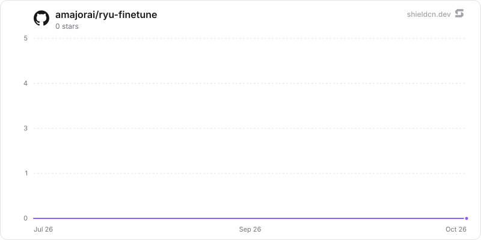

<div align="center">

# finetune

</div>

A LoRA/QLoRA training studio: durable job state, the trained-adapter catalog, and the Python training sidecar.

> **The public home of `ryu-finetune`.** Source, builds, and releases live here —
> binaries for every platform are attached to each release.
>
> This tree is generated from the Ryu monorepo, so commits pushed here
> directly are replaced on the next sync. **Pull requests are welcome** —
> open them here and they are ported into the monorepo, then flow back out.
> Ryu as a whole: https://github.com/amajorai/ryu

## Install

**App:** [Install](ryu://apps/com.ryu.finetune) (opens the Ryu desktop app and asks you to confirm)

**CLI:**

```bash
ryu apps add com.ryu.finetune
```

**From source:**

```bash
cargo build --release --manifest-path backend/Cargo.toml
```

Prebuilt binaries for every platform are attached to [each release](https://github.com/amajorai/ryu/releases).

## License

Apache-2.0 — see [LICENSE](./LICENSE).

## Parts

- **`backend/` — `ryu-finetune` (out-of-process control-plane sidecar).** An extracted
  Core capability crate now run as a standalone `[[bin]]` (`kind:local`, `public_mount`,
  `RYU_FINETUNE_BIN`/`RYU_FINETUNE_PORT`, default `:7990`); Core links **zero finetune
  code** (no path-dep) and proxies `/api/finetune/*` to it. It owns the *durable* records
  that must survive a restart: the `FinetuneStore` job DB (`finetune.db`) and the
  trained-adapter catalog (`installed-adapters.json`), plus the Python `unsloth` worker
  (over loopback at its profile-shifted manifest port). Core keeps no fine-tune client: it serves the sidecar only
  through the generic ext-proxy (`/api/ext/@ryu/finetune/*` and the `/api/finetune`
  public mount) and, for the learning loop's reward-filtered retrain, calls the
  `finetune.start` / `finetune.merge` capabilities this manifest `provides`.
- **`sidecar/` — `ryu-unsloth` (out-of-process Python sidecar).** A FastAPI runtime
  wrapping the Apache-2.0 `unsloth` library + TRL `SFTTrainer` behind one small HTTP
  contract; the actual training runs here. Base server deps boot on any machine; the
  heavy training stack (`unsloth`/`torch`/CUDA/`trl`) is the optional `[train]`
  extra so `/health` serves even without a GPU. Manifest-managed: provisioned from a
  hosted tarball and started on enable + boot-reconcile.
- **`ui/` — companion (`@ryu/finetune-app`).** A sandboxed full-page Companion
  (Path B, `ui_format: "html"`), one self-contained `dist/index.html`. Drives the
  sidecar's `/api/finetune/*` routes through the generic own-app bridge
  (`window.ryu.app.request`, grant `app:http`) and reads live progress through
  `window.ryu.finetune.stream` (grant `finetune:runs`), which the host serves from the
  same sidecar's SSE route via the ext-proxy.

## At rest

Fine-tuned weights are **not encrypted**: the training stack, the GGUF converter and
llama.cpp read (and mmap) them by path. They are kept owner-only instead (`ryu_unsloth/paths.py`):

- LoRA adapters (`<data dir>/models/adapters/<stem>/`): folder 0700, files 0600, applied
  after each save and to existing adapters at every start.
- Merged GGUFs (`<data dir>/models/chat/<stem>.gguf`): the file is 0600 before it is moved
  into the shared chat-model folder (that folder itself is not narrowed).
- Trainer checkpoints (`plugin-data/@ryu+finetune/checkpoints/<job>/`) and the GGUF export
  scratch (`plugin-data/@ryu+finetune/tmp/gguf-*`): 0700, deleted when the job or merge ends;
  the worker's startup sweep deletes any that a crash left behind (jobs live in memory, so
  nothing found at startup is in use). Symlinks are never followed.
- Datasets: the Companion sends rows in the request, and the worker holds them in memory.
  Files a user places in `plugin-data/@ryu+finetune/datasets/` are read as they are
  (plaintext); the folder is made 0700 at startup.

Weights trained on private data can memorize and reproduce it; treat adapters and merged
models like the dataset. `installed-adapters.json` holds metadata only (stem, base model,
job id, path, time). The remote GPU token keeps its existing sealing in the backend store.
On Windows these permission calls are skipped and the per-user data folder's ACL applies.

## Manifest (`manifest.json`)

- **Grants:** `app:http` (own-sidecar requests), `finetune:runs` (live progress stream).
- **Provides:** `finetune.start` (`/start`) and `finetune.merge` (`/merge`) on
  `ryu-finetune`, each gated on `finetune:runs`. Core's learning loop is the consumer.
- **Sidecar:** `unsloth` on `:8086`, `process.kind: python`, entry `ryu_unsloth`,
  Python 3.11, `pyproject_extra: train`; source is a hosted `tar.gz` release
  (`unsloth-sidecar-v1`) auto-published from the public repo mirror.
- **Runnable:** one `companion` (`Fine-tuning`, icon `sparkles`).

## Split of concerns / swap seam

Core owns *what runs* (GPU gate, job store, adapter→GGUF merge, model registration);
the Python sidecar only trains; the durable crate only persists. Training backend and
the record store are independently swappable behind the `/api/finetune/*` contract.

## Star History

<a href="https://github.com/amajorai/ryu-finetune/stargazers">
  <picture>
    <source media="(prefers-color-scheme: dark)" srcset="./.github/shieldcn/star-chart-dark.svg" />
    
  </picture>
</a>
